# 독립 SVG 설명 예제

시간은 설명을 위해 정한 예시입니다. 움직임을 끄더라도 구성 요소와 화살표 및 전체 사건 순서를
읽을 수 있습니다. 각 SVG는 같은 이름의 JSON을 편집한 뒤 패키지의 생성기로 다시 만듭니다.
외부 글꼴이나 플레이어가 필요하지 않으며, 한국어 글꼴은 읽는 환경에서 제공해야 합니다.

## 대기열 처리

작업 등록, 대기 후 처리, 완료 알림의 순서를 보여 줍니다.

## 재시도

첫 전송 이후 대기 시간을 두고 같은 경로로 다시 보내는 순서를 보여 줍니다.

## 사건 전파

두 수신자에게 같은 시점에 사건을 보냅니다. 경로 길이가 달라도 예시 도착 시점은 같습니다.

XML과 생성 결과의 일치 검사는 재생 검증을 대체하지 않습니다. GitHub나 다른 문서 서비스의
표시 정책이 바뀌면 정적 형태로 보일 수 있습니다. 해당 환경에서 확인한 결과만 보고해야 합니다.
